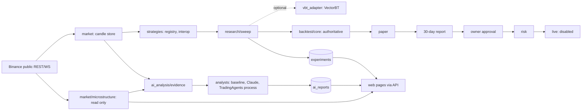

# External repositories: audit, integration plan and status

Date: 2026-11-05. Branch: `quantlab-integrations` (not deployed). Every upstream fact below was
read from a shallow clone of the repository or from PyPI on this date, or measured by running it.

## 1. Headline

- **Nothing here is evidence of profit.** All numbers are research output.
- The 30-day paper test on the server was not touched. Nothing was deployed. Live trading stays
  behind ADR-0008; no new code path can reach it (tests below).
- Of the four projects, **none became a required dependency**. VectorBT is an optional library.
  Jesse and Hummingbot contributed concepts only. TradingAgents is an optional separate process.
- **The spec's premise differs from the repo.** It says to keep Freqtrade as the execution core.
  The deployed system's authoritative engine is `quantlab/` (ADR-0007); Freqtrade is the older
  part and runs nowhere in the deployment. This work treats `quantlab` as authoritative, because
  adding a second engine is what the spec forbids. See ADR-0010.

## 2. Current repository

| Item | Finding |
|---|---|
| Runtime | Python 3.13.15; pandas 3.1, numpy 2.5 in `.venv`. `quantlab/requirements.txt` uses lower bounds only |
| Freqtrade | `2026.7-dev` in `freqtrade/`; only `freqtrade/islamic/screening.py` is used by the deployed image |
| Engines | `backtest/core.py` shared by backtest and paper; live in `live/engine.py` |
| Strategies | 10 technical, Rule Builder, 5 ML algorithms; registry in `strategies/base.py` |
| State | SQLAlchemy + Alembic. SQLite locally, PostgreSQL on the server |
| Spec modules | market_data=`market/`, strategy_registry=`strategies/`, research=`research/`, backtesting=`backtest/`, ml_research=`ml/`, paper_trading=`paper/`, risk=`risk/`, live_execution=`live/`, web_api=`api/`. Only `ai_analysis/` is new. The existing layout was kept rather than renamed |

## 3. Upstream audit

| | Jesse | Hummingbot | VectorBT | TradingAgents |
|---|---|---|---|---|
| Audited | 3.6.0, `8665b25`, 2026-11-03 | 2.17.0, `9af100d`, 2026-09-22 | 1.2.0, `c923f74`, 2026-11-03 | 0.7.1, `9fa1196`, 2026-11-04 |
| Licence | MIT | Apache-2.0 | **Apache-2.0 + Commons Clause** | Apache-2.0 |
| Python | >=3.10 | >=3.10.12, Cython build | >=3.11,<3.15 | >=3.11 |
| Maintained | Yes | Yes | Yes | Yes |
| Key conflict | `pandas~=2.2.3`, `peewee~=3.14.8`, `ray`; `pip install jesse` **failed** wheel-only on 3.13 | Whole connector stack; compiled extensions | `pandas>=3`, `numpy>=2.4.6`: compatible. **833 MB venv** | `pandas>=3`, langchain, langgraph; **450 MB venv** |
| Decision | Custom implementation of concepts | Custom implementation of concepts | Optional dependency + adapter | Isolated process + adapter, off by default |

### Capabilities taken

| Source | Upstream reference | Quant Lab | Mode |
|---|---|---|---|
| Jesse | `Strategy.should_long`, `update_position` | `strategies/interop.py` JSON spec | Concept |
| Jesse | `jesse.research.monte_carlo_trades` | `research/robustness.py` | Concept, own code |
| Hummingbot | `OrderBook.get_price`, `get_vwap_for_volume` | `market/microstructure.py` | Concept, own code |
| Hummingbot | `controllers/market_making`, arbitrage | Fee-versus-spread check only | Concept. No order path |
| VectorBT | `Portfolio.from_signals` | `research/vbt_adapter.py` | Optional library |
| TradingAgents | `TradingAgentsGraph.propagate(..., asset_type="crypto")` | `ai_analysis/tradingagents_runner.py` | Separate venv |
| TradingAgents | Structured analyst output idea | `ai_analysis/schema.py` | Concept |

### TradingAgents: no Binance adapter

The spec allows one only if upstream supports it cleanly. It does not: vendors are a fixed map in
`dataflows/router.py`, and the crypto path normalises `BTCUSDT` to Yahoo's `BTC-USD`. Patching that
map would be a fork in disguise. So the default analyst uses Quant Lab's own pack of timestamped
Binance data, and a TradingAgents result is stored at low confidence with the Yahoo source stated
in `missing_data`.

## 4. Architecture



Nothing crosses from `experiments`, `ai_reports` or external code into `paper`, `risk` or `live`.
`test_ai_package_cannot_reach_trading_modules` and `test_trading_modules_do_not_read_ai_or_experiments`
enforce both directions. A paper candidate does not start a session; the owner would do that.

## 5. Measured results

### VectorBT against the authoritative engine

3 pairs, 4h candles, full walk-forward and final runs:

| Backend | Sets | Runtime | Peak memory | Selected set and test result |
|---|---:|---:|---:|---|
| Native | 96 | 13.2 s | 194 MB | identical |
| VectorBT | 96 | 6.1 s | 1,115 MB | identical |
| Native | 576 | 83.0 s | 239 MB | identical |
| VectorBT | 576 | 26.2 s | 3,687 MB | identical |

**Conclusion:** VectorBT is 2-3x faster here, not orders of magnitude, because signals and metrics
are still computed per set, and it costs about 15x the memory. It is not worth installing on the
memory-limited shared server. The default is native, limit 1000 sets. VectorBT remains useful on a
workstation for grids above that.

| Difference | Status |
|---|---|
| Signal timing, next-open | Identical: adapter shifts signals, `price=open` |
| Fees, slippage | Identical on real and synthetic candles |
| Order sizing | Identical: fraction of cash, fee included |
| Cash and position accounting | Identical without stops (equity, drawdown, fees) |
| Entry and exit on one candle | Identical after `resolve_conflicts`. Upstream's modes cannot express the engine's rule |
| Lot-size rounding | **Differs by design.** VectorBT `size_granularity` left dust and blocked entries on real BTC: 36 trades, -10.38%, versus the engine's 44 and -4.07%. Not used; the gap is then about 0.1 point |
| Minimum notional | Engine only |
| Stops | Close, not equal; same-candle order and gaps differ |
| Partial fills | Modelled by neither |

The sweep stores the gap per pair, and a gap above 3 points fails the gate.

### Jesse against the authoritative engine

Real Jesse 3.6.0 in its own venv, real Binance BTC/USDT, 2026-08-01 to 2026-11-01, 1h execution
timeframe with 1m source candles, fee 0.1%, no slippage, 95% stake. Output is committed as a fixture.

| Strategy | Trades | Jesse | Quant Lab | Fees Jesse / ours |
|---|---:|---:|---:|---|
| EMA Cross | 21 / 21 | +7.28% | +7.29% | 4.58 / 4.59 |
| RSI Trend | 7 / 7 | +7.96% | +7.99% | 1.39 / 1.39 |

Every entry and exit falls on the same signal candle. Results are close and **not equal**: Jesse
fills at the signal candle's close and takes the spot fee from the coin; ours fills at the next
open. These were 3 months of one market and say nothing about future results. Jesse ran with
unpinned newer dependencies and without `ray`/PostgreSQL, since its pins do not install on 3.13,
so this is a real Jesse run but not its supported environment.

Seven indicators (RSI, EMA, SMA, MACD, Bollinger, ATR, ADX) match Jesse's own code within 1e-5
relative over the last 500 candles. RSI, ATR, ADX and the MACD signal differ during early warm-up.
Coverage is 7 of Jesse's indicators; the rest are listed in the compatibility report, in-app and at
`GET /jesse/compatibility`, with order types, timeframes and execution differences.

### Example experiment on real data

Data ends 2026-11-05; train and validation were bull periods, test was bear on all pairs.

| Experiment | Test median | Trades (sum) | Drawdown | WF positive | Status |
|---|---:|---:|---:|---:|---|
| RSI+EMA, 576 sets, 4y, BTC/ETH/SOL | -5.54% | 29 | -9.58% | 42% | Rejected |
| Jesse RSI Trend, fixed | not opened | | | 67% | Rejected: too few validation trades, so no selection |
| Jesse EMA Cross, fixed | +16.13% | 44 | -22.87% | 67% | **Paper candidate** |

Treat the candidate with caution: ETH lost 17.0% in the same test, the Monte Carlo bootstrap puts
the 5th percentile near -50% with a 41.6% chance of loss, and the drawdown is close to the 25%
limit. It was one fixed example and it was not re-tuned. It is a reason to observe it on paper at
most, and it should not join the running test before 2026-12-04.

### Order book, real BTC/USDT

Spread about 0.001 bps, ±10 bps depth about 6-9M USDT. 100 USDT costs about 0.001 bps. **Maker
round trip: spread 0.001 bps minus fees 20 bps = about -20 bps** at the default 0.1% fee. This is why
market-making stays a calculation and not a feature at this size. The 500-level book did not reach
±50 bps, and the page marks those bands as lower bounds.

## 6. Anti-overfitting rules in code

`research/sweep.py`: chronological non-overlapping segments, each starting flat; causal signals;
selection on median validation Sharpe, never on return; walk-forward inside train+validation; test
run once for the chosen set; `test_test_segment_cannot_influence_the_choice` corrupts test candles
and asserts the choice, train, validation and walk-forward stay identical. All sets and failed runs
are stored. Sharpe is hidden below 10 trades. Parameter sensitivity, Monte Carlo, symbol and regime
coverage are reported and gated. The strategy page has no return-based ranking.

Gates live in `sweep.GATES`. Passing gives `paper_candidate`, never a live status.

**Weakness:** selecting from N sets inflates validation results and no deflated-Sharpe correction
is applied; the trial count is shown and the sealed test is the counterweight.

## 7. Status

### Implemented, run and tested

- Order-book metrics, freshness and failure states; web page (real data in Chromium).
- Sweep engine, both backends, experiment storage, CSV export, comparison; web page (real data).
- Jesse spec format, two example strategies, compatibility report, comparison with real Jesse.
- Unified strategy evaluation page; integration status page with switches, versions, licences, logs.
- AI report storage, evidence pack, validation, limits, outcome scoring, scoreboard; rule baseline
  end to end on real data; web page.
- Migration 0003 (adds tables only; `compare_metadata` reports no drift).

### Partial

- **Claude analyst:** written and tested against the real SDK with a mock transport. **Never called
  the real API**, so acceptance of the schema and output quality are unverified. Needs `QL_AI_API_KEY`.
  It uses `fallbacks: "default"`, so a declined request may be answered by another model.
- **TradingAgents analyst:** the package installs and imports in a separate venv and the `propagate`
  signature matches; mapping is tested on a fixture. **Never run end to end**: needs an LLM key.
- **AI outcomes:** the scoring logic is tested, but no real report has reached its horizon yet.
- **Regime robustness:** segments are labelled by buy-and-hold return. No per-regime strategy result.
- **Deploy:** Docker build args are written but the image was not built here.

### Deferred

- Market-making and arbitrage simulation: only the fee-versus-spread check exists. With 20 bps of
  round-trip fees against a sub-bps spread there is little to simulate at this size.
- Multi-timeframe strategies; Jesse limit/stop entries; order-book history (snapshots are not stored).
- Scheduled AI reports: deliberately manual, so nothing spends money unattended.
- News and sentiment: unavailable, and stated as such in every report.

### Known issue, not caused by this work

The dashboard crashes with `Cannot read properties of undefined (reading 'price')` when the market
worker has not yet produced tickers (`generated/Dashboard.tsx:77`). Seen in the isolated test and
gone once that worker ran. Not fixed here: it is outside this scope and the file is codemod output.

## 8. Licence obligations

See `quantlab/THIRD_PARTY_NOTICES.md`. Key point: if this system is ever sold as a service whose
value comes substantially from VectorBT, the Commons Clause forbids that. Personal use is fine.
Removal is simple: uninstall it and sweeps use the native engine.

## 9. API

All need the session cookie; mutations also need `X-QL: 1`.

| Route | Purpose |
|---|---|
| `GET /integrations`, `POST /integrations/{key}` `{enabled}` | Status; switch. Off gives 409 on the feature's routes |
| `GET /jesse/compatibility` | Compatibility report and specs |
| `GET /market/microstructure?pair=&notional=` | `status` ok, stale or error; `age_seconds`, `error`, `metrics` |
| `GET /experiments/presets` | Presets, backends, limits, gates |
| `POST /experiments` | Queue a sweep. Body: `strategy, pairs[], timeframe, start_ts, end_ts, grid, backend, fee, slippage, stake_pct, stoploss_pct, train, validation, folds, min_trades` |
| `GET /experiments`, `GET /experiments/{id}` | List; summary with repro metadata |
| `GET /experiments/{id}/results?limit=&offset=`, `/export.csv` | All parameter sets |
| `GET /strategy-evaluation` | Unified view and latest paper report |
| `GET /ai/status` | Enabled, engines, 24h usage, limits, scoreboard |
| `POST /ai/reports` `{pair, timeframe, engine}` | Queue. 409 if off or unconfigured, 429 over limit |
| `GET /ai/reports`, `GET /ai/reports/{id}`, `POST /ai/outcomes` | History; full report; score past views |

Stored per experiment: ID, strategy and version, pairs and range, grid, fee and slippage, splits,
return, net PnL, trades, profit factor, drawdown, Sharpe/Sortino, runtime, reproducibility metadata
(data hash, library versions, seed).

## 10. Reproduce

```sh
.venv/bin/pip install -r quantlab/requirements-research.txt -r quantlab/requirements-ai.txt  # optional
.venv/bin/python -m pytest tests_quantlab -c /dev/null --rootdir=. -p no:asyncio
(cd web && npx vitest run && npx tsc --noEmit && npx next build)

# Regenerate the Jesse fixture, in a venv of its own and never in .venv
python3.13 -m venv /tmp/jv && /tmp/jv/bin/pip install --no-deps jesse==3.6.0 jesse-rust==1.3.1
# then add its imports one at a time, as its pins do not resolve on 3.13
/tmp/jv/bin/python -I tests_quantlab/fixtures/jesse/run_jesse_parity.py tests_quantlab/fixtures/jesse
/tmp/jv/bin/python -I tests_quantlab/fixtures/jesse/gen_indicator_fixture.py tests_quantlab/fixtures/jesse
```
